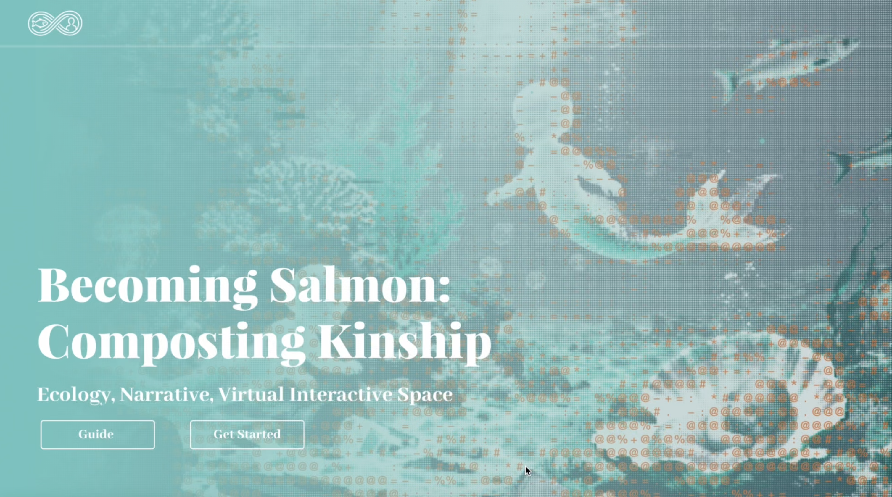
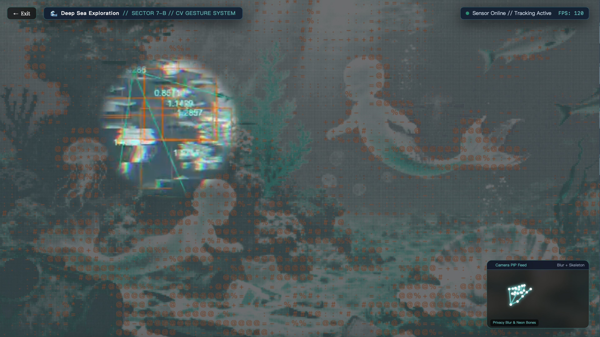
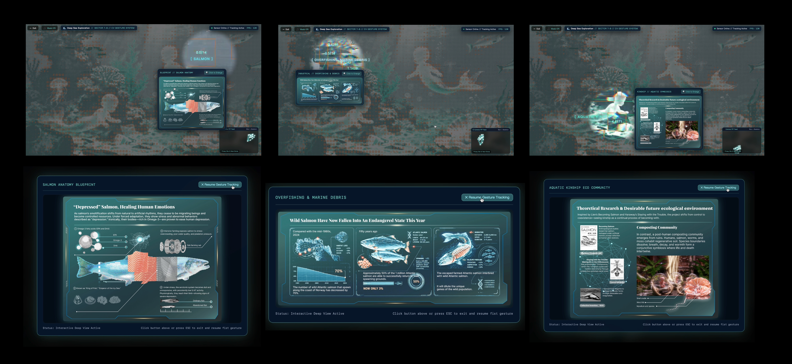

# 🌊 Becoming Salmon: Composting Kinship - Immersive Eco-Interactive Web Experience

> An interactive web art project blending computer vision (MediaPipe), real-time WebGL shaders (Three.js), and post-human ecological speculation.

[](https://github.com/xy-art-web/salmon-kinship-interactive)
[](LICENSE)

---

## 📌 1. Design Philosophy
*Becoming Salmon: Composting Kinship* is a digital art and interactive design project exploring post-human ecology, industrial salmon aquaculture, and ecological deconstruction. 
* By leveraging non-contact computer vision gesture recognition, the project breaks away from traditional one-way presentations, guiding viewers to transition from passive "spectators" to active "ecological explorers."
* It aims to provoke public reflection on symbiotic relationships and ecological ethics in the post-human era through immersive deep-sea lighting and tactile interaction.

---

## 🎯 2. Target Audience
* Digital media art enthusiasts and new media interaction designers.
* Ecological design researchers and individuals interested in post-humanist themes and sustainable futures.

---

## 🛠️ 3. Core Interactions & Mechanics
The project adopts a dual-layer viewport architecture driven by real-time shaders. Its core interactive features include:

| Module | Technology | User Action & Feedback |
| :--- | :--- | :--- |
| **🏠 Landing Page & Atmosphere** | HTML5 / Tailwind CSS / CSS3 Animations | Features a deep-sea particle background and breathing glowing effects upon load; clicking the **"Guide"** button triggers a smooth spring-bounce modal animation with precisely aligned borders. |
| **🖐️ Computer Vision Gesture Tracking** | MediaPipe Hands + Camera Utils | The bottom-right Picture-in-Picture (PIP) window displays a privacy-blurred camera feed overlaid with glowing neon-cyan hand tracking skeleton bones. |
| **🔍 Fishery Monitoring Cursor** | WebGL 2D/3D Shader Blending | When the user makes a **"fist"** gesture in front of the camera, the system dynamically drives and controls the fishery monitoring cursor to scan and reveal hidden ecological keywords (`OVERFISHING, MARINE DEBRIS`, `SALMON`, `AQUATIC KINSHIP`) across the dark deep-sea background, automatically triggering high-resolution data visualization cards with zoom-in capabilities. |
| **🌊 Immersive Environment & Reset** | JavaScript State Management | The top-left corner of the secondary exploration view features an **"Exit"** button paired with a background music (BGM) toggle, allowing users to smoothly return to the main login page at any time. |

---

## 📸 4. Screenshots & Visual Showcase

* **1. Primary Landing Page**:
  
  > *✨ Description: The initial loading interface presents a deep-sea particle atmosphere with breathing glowing effects. Users can click **"Get Started"** to enter the exploration or open the **"Guide"** modal for gesture instructions.*

* **2. Secondary Exploration View & Gesture Tracking**:
  
  > *✨ Description: Inside the secondary exploration viewport, the bottom-right PIP window displays real-time hand-tracking skeletons. Users use a closed-fist gesture to drive a spotlight cursor, actively scanning and uncovering hidden ecological keywords across the dark deep-sea background.*

* **3. Floating Data Visualization Cards & HD View**:
  
  > *✨ Description: Once the gesture cursor hits hidden keywords (e.g., `OVERFISHING, MARINE DEBRIS`, `SALMON`, `AQUATIC KINSHIP`), floating data cards automatically pop up. These cards showcase multi-species kinship data and industrial aquaculture deconstruction, supporting high-resolution zoom views to complete the interactive loop.*

---

## 🚀 5. Quick Start & Usage
This is a purely front-end-based browser project requiring no complex backend setup.

1. **Video Demo**: [📺 Watch the Full YouTube Demonstration Video](https://youtu.be/xU7JrCWnEGs)
2. **Clone the Repository**:
   ```bash
   git clone [https://github.com/xy-art-web/salmon-kinship-interactive.git](https://github.com/xy-art-web/salmon-kinship-interactive.git)
